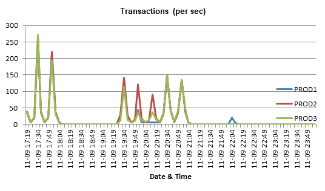

# AwrOne — Oracle AWR to Excel

Convert Oracle AWR data into Excel workbooks with charts.

An INI file defines what to collect (SQL queries, sheet layout, charts).
The pipeline collects from the database via SQL*Plus HTML spool and turns the
result into a formatted `.xlsx` with line charts per metric.

> Korean version: [README_ko.md](README_ko.md)
> (For Tibero TPR, see the sibling tool **TprOne** in [`../Tibero/`](../Tibero/).)

## Pipeline

```
INI ──AwrONE_ini_to_sql.py──▶ .sql ──SQL*Plus (spool HTML)──▶ .html ──AwrONE_html_to_excel.py──▶ .xlsx (with charts)
```

## Usage

### 1. Generate the collection SQL

```bash
python AwrONE_ini_to_sql.py -i Simple_AwrOne_2node.ini -o out.sql
```

### 2. Set the collection time window (required)

Open the generated `out.sql` and edit the two lines near the top:

```sql
exec :snapdate_from:=202611091705
exec :snapdate_to:=202611092359
```

- Format: `YYYYMMDDHH24MI` (year, month, day, hour, minute — local DB time).
- The shipped defaults (`202601010000`–`202601150000`) are placeholders;
  always set the range you actually want (e.g. an incident window or the last day).
- Snapshots whose interval overlaps the window are collected. If none overlap,
  the script stops with `ORA-20001: No AWR snapshots found ...`.
- `:inst_no` and `:dbid` are auto-detected from the connection — you only edit
  the two dates. For RAC ini files the instance numbers are preset
  (`:inst_no1:=1` … `:inst_noN:=N`); adjust them if your instances are
  numbered differently.

### 3. Collect with SQL*Plus

Run anywhere that has SQL*Plus and network access to the DB — there is no fixed
directory; the HTML report is written to the current directory.

- Single-family ini: run **once per node**, connecting to each instance
  (put `INSTANCE_NAME` in the connect string).
- RAC-family ini: run **once** against any instance — the queries already cover
  the whole cluster. (A `4node` ini on a 3-node cluster still works; the missing
  node shows as `inst#4` with no data.)

```bash
# Single family — once per node
sqlplus appdba/manager@"(DESCRIPTION=(ADDRESS=(PROTOCOL=TCP)(HOST=<node-vip>)(PORT=1521))(CONNECT_DATA=(SERVICE_NAME=<svc>)(INSTANCE_NAME=<inst>)))" @out.sql

# RAC family — once, any node
sqlplus appdba/manager@<host>/<svc> @out.sql
```

### 4. Convert to Excel

```bash
python AwrONE_html_to_excel.py -i AWR_RAC_Simple_2node_rac1_PROD1_20261110_192130.html
```

The converter reads the source ini name recorded inside the HTML and searches
the report's directory, the working directory, and the script directory; use
`-n <ini>` to override. The `.xlsx` (with charts) is written next to the HTML.
For `*_with_ash.ini` collections, convert the extra `..._ASH.html` the same way.

## Sample output

| `load` — Transactions/s per node | `rac_load` — Global Cache blocks received/s |
|---|---|
|  |  |

## Requirements

- Python 3.x standard library + `xlsxwriter` (`openpyxl` only for the verification scripts under `test/`)
- Oracle **12.2 or later** (queries are CDB/PDB-aware via `con_id`); SQL*Plus client
- AWR read access (Diagnostics Pack; an account with SELECT on `DBA_HIST_*`)

## Collection INI set

| ini | Purpose | How to run |
|---|---|---|
| `Simple_AwrOne_Single.ini` | Single-instance key metrics | Run on each RAC node |
| `Simple_AwrOne_Single_with_ash.ini` | Same + ASH (separate `_ASH.html`) | 〃 |
| `Full_AwrOne_Single.ini` | Single-instance full set (Top SQL, segments, ...) | 〃 |
| `Full_AwrOne_Single_with_ash.ini` | Same + ASH | 〃 |
| `Simple_AwrOne_{2..8}node.ini` | RAC node-comparison key metrics (2 to 8 nodes) | Once (cluster-wide) |
| `Full_AwrOne_{2..8}node.ini` | RAC node-comparison full set (2 to 8 nodes) | 〃 |

### Simple vs Full — Collected `[section]` Reference

#### 1. Single-Instance INIs (`Simple_AwrOne_Single.ini` vs `Full_AwrOne_Single.ini`)

- **`Simple` (33 sheets — included in both `Simple` and `Full`)**:
  - **Environment & Parameters**:
    - `[dbinfo]` — Instance, host, database name, DBID, version, RAC status, snapshot window
    - `[snapinfo]` — AWR snapshot IDs, timestamps, interval duration, instance startup time
    - `[param]` — Non-default / all database initialization parameters
    - `[param_sga]` — Memory and SGA/PGA sizing parameters (`sga_target`, `db_cache_size`, `shared_pool_size`, ...)
  - **Workload & RAC Profile**:
    - `[load]` — Load Profile time series (DB Time, DB CPU, redo, logical/physical reads & writes, MB/s, user calls, parses, hard parses, sorts, logons, executes, transactions, hit ratios)
    - `[rac_load]` — Global Cache blocks received/served, interconnect traffic, CR/current build & send times
    - `[rac_gc_efficiency]` — Buffer access efficiency breakdown (`local %`, `remote %`, `disk %`)
    - `[time_model]` — Time Model statistics (`DB time`, `DB CPU`, SQL execute, parse, hard parse, PL/SQL, connection management)
    - `[osstat]` — OS CPU utilization (`busy`, `user`, `sys`, `iowait`, `idle`), load average, CPU/core/socket counts, physical memory
    - `[inst_activity]` — Key instance activity counters (`user commits`, `user rollbacks`, `execute count`, `parse count`, `redo entries`, `table scans`, ...)
    - `[sysstat_key]` — Key `DBA_HIST_SYSSTAT` internal counters (index splits, block cleanouts, buffer scans, DBWR checkpoints, redo entries)
    - `[xd_sysstat]` — Exadata Smart Scan / storage cell offload statistics
  - **Wait Events & Services**:
    - `[wait5]` — Top 5 Foreground Timed Events per snapshot (waits, time, avg wait ms, `% DB time`)
    - `[wait20]` — Top 20 Foreground Timed Events per snapshot (waits, time, avg wait ms, `% DB time`)
    - `[wait15_raw]` — Raw Top 15 wait events per snapshot (`wait_class`, waits, timeouts, time waited, avg wait)
    - `[wait_disk]` — Disk I/O wait breakdown (`db file sequential read`, `scattered read`, `direct path read/write`, ...)
    - `[redo_wait]` — Redo & commit wait breakdown (`log file sync`, `log file parallel write`, `log file switch*`, `log buffer space`)
    - `[wait_buffer]` — Buffer contention wait breakdown (`buffer busy waits`, `read by other session`, `free buffer waits`, `gc buffer busy*`, `write complete waits`)
    - `[waitstat]` — Buffer wait statistics by block class (`data block`, `undo header`, `undo block`, `segment header`)
    - `[service_wait]` — Per-service DB time, CPU time, physical/logical reads, and wait class breakdown
  - **Memory, Undo, Redo & Concurrency**:
    - `[sga]` — SGA component sizes over time (buffer cache, shared pool, large pool, java pool, streams pool, free memory)
    - `[pga]` — PGA memory advisory/usage (`total PGA allocated`, `total PGA inuse`, `maximum PGA allocated`, cache hit %)
    - `[pga_hit]` — SQL workarea execution breakdown (`optimal %`, `onepass %`, `multipass %`)
    - `[libcache]` — Library cache activity by namespace (gets, pins, pin hit %, reloads, invalidations)
    - `[latch]` — Top 5 latches by wait time (wait time, miss ratio %, misses)
    - `[enq]` — Top 5 enqueue lock waits by total wait time
    - `[undo]` — Undo segment usage (undo blocks, transaction count, max query length, `ORA-01555` snapshot too old, space errors)
    - `[mttr]` — Instance recovery MTTR target vs estimated recovery time and dirty buffer counts
    - `[resource]` — `DBA_HIST_RESOURCE_LIMIT` utilization (`processes`, `sessions`, `enqueue_locks`, `max_rollback_segments`)
    - `[log_ckpt]` — Redo log switch interval statistics (min/max/avg switch gap in minutes by thread)
    - `[logswitch]` — Hourly redo log switch count matrix by thread (`Thread#1..4`)
    - `[archsize]` — Daily archived redo log count and size (MB) by thread
    - `[sqlstat]` — Per-snapshot SQL summary across captured statements (SQL count, single-use SQL, executions, buffer gets, disk reads, CPU/elapsed time)

- **`Full` (adds 69 detail sheets on top of `Simple` = 102 sheets total)**:
  - **RAC Interconnect Deep-Dive**:
    - `[rac_char]` — Global Enqueue / Global Cache service latency and message timings
    - `[rac_msg]` — Interconnect message queue/send latency and ticket statistics
    - `[rac_gesstat]` — Key DLM/GES statistics (`DBA_HIST_DLM_MISC`: messages sent/received, flow control, queue time)
    - `[rac_gccr_srv]` — Global Cache CR block server statistics (build, flush, send times and counts)
    - `[rac_gccu_srv]` — Global Cache Current block server statistics (pin, flush, send times and counts)
    - `[rac_gctran]` / `[rac_gctran_raw]` — Global Cache block transfer & convert summary and raw per-class breakdown
  - **Top SQL by 7 Metrics (3 sheets per metric = 21 sheets + `[sql_stat]`)**:
    - `[sql_ela]` / `[sql_ela2]` / `[sql_ela_raw]` — Top 10 SQL by **Elapsed Time** (time-series chart, summary with SQL text, per-snapshot raw ranking)
    - `[sql_cpu]` / `[sql_cpu2]` / `[sql_cpu_raw]` — Top 10 SQL by **CPU Time**
    - `[sql_get]` / `[sql_get2]` / `[sql_get_raw]` — Top 10 SQL by **Buffer Gets (Logical I/O)**
    - `[sql_read]` / `[sql_read2]` / `[sql_read_raw]` — Top 10 SQL by **Disk Reads (Physical I/O)**
    - `[sql_exe]` / `[sql_exe2]` / `[sql_exe_raw]` — Top 10 SQL by **Executions**
    - `[sql_parse]` / `[sql_parse2]` / `[sql_parse_raw]` — Top 10 SQL by **Parse Calls**
    - `[sql_clwait]` / `[sql_clwait2]` / `[sql_clwait_raw]` — Top 10 SQL by **Cluster Wait Time**
    - `[sql_stat]` — Extended per-snapshot SQL execution and bind/plan rollup
  - **Top Segments by 11 Metrics**:
    - `[seg_stat_lio]` — Top 5 segments by Logical Reads
    - `[seg_stat_pio]` — Top 5 segments by Physical Reads
    - `[seg_stat_bbw]` — Top 5 segments by Buffer Busy Waits
    - `[seg_stat_rlw]` — Top 5 segments by Row Lock Waits
    - `[seg_stat_itlw]` — Top 5 segments by ITL Waits
    - `[seg_stat_gccrsv]` / `[seg_stat_gccusv]` — Top 5 segments by GC CR / Current blocks served
    - `[seg_stat_gccrrc]` / `[seg_stat_gccurc]` — Top 5 segments by GC CR / Current blocks received
    - `[seg_stat_gcbb]` — Top 5 segments by GC Buffer Busy waits
    - `[seg_stat_spused]` — Top 5 segments by Space Used delta
  - **Tablespace & Datafile I/O**:
    - `[tbsstat_total]` / `[filestat_total]` — Full per-snapshot tablespace and datafile I/O statistics table
    - `[tbsstat]` / `[filestat]` — Top 5 tablespaces and datafiles by physical reads time series
    - `[filestat_avg_blks_per_rd]` — Top 5 datafiles by average blocks per read
    - `[filestat_avg_time_per_rd]` / `[filestat_avg_time_per_rd_topio]` — Top 5 datafiles by average read latency (ms) and raw list
    - `[filestat_avg_bwt]` / `[filestat_avg_bwt_topio]` — Top 5 datafiles by buffer wait time and raw list
  - **Service, Memory, Lock & Parameter Details**:
    - `[service_stat]` / `[service_stat_dbtime]` / `[service_stat_dbcpu]` / `[service_stat_lio]` / `[service_stat_pio]` — Per-service time series by DB Time, DB CPU, Logical Reads, Physical Reads
    - `[wait5_raw]` — Top 5 wait events raw table per snapshot
    - `[workarea]` / `[workarea_raw]` — SQL workarea memory histogram and raw breakdown
    - `[bufpool]` / `[bufpool_other]` — Default/Keep/Recycle and non-standard block size buffer pool statistics
    - `[enq_av]` — Top 5 enqueue locks by average wait time
    - `[undo_sql]` — Undo usage correlated with max-query SQL IDs
    - `[latch_sleep]` / `[latch_miss]` / `[mutex_sleep]` — Top 5 latches by sleeps/miss ratio and library cache mutex sleeps
    - `[rowcache]` — Active Dictionary Cache (`DBA_HIST_ROWCACHE_SUMMARY`) gets, misses, scans, and DLM activity
    - `[redo]` — Redo log group configuration (`v$log` / `v$logfile`)
    - `[sess_cache]` — Session count and session cursor cache hit statistics
    - `[param_diff]` — History of initialization parameters modified across snapshots

- **`*_with_ash.ini` (appends 1 sheet spooled to `..._ASH.html`)**:
  - `[ash]` — Active Session History (`DBA_HIST_ACTIVE_SESS_HISTORY`) raw samples within the window (capped at 150,000 rows)

---

#### 2. Multi-Node RAC INIs (`Simple_AwrOne_{2..8}node.ini` vs `Full_AwrOne_{2..8}node.ini`)

- **`Simple` (9 sheets — cluster-wide node-by-node comparison)**:
  - `[dbinfo]` — Cluster database info and active instances
  - `[snapinfo]` — Per-instance snapshot range summary
  - `[param]` — Side-by-side initialization parameter comparison across nodes (`#1`..`#N`)
  - `[load]` — Per-node Load Profile comparison (DB Time, DB CPU, Redo, Logical/Physical Reads, User Calls, Executions, Parses, Transactions, etc.)
  - `[rac_load]` — Per-node Global Cache blocks received/served, interconnect traffic, and physical I/O
  - `[rac_char]` — Per-node Global Cache / Enqueue latency comparison
  - `[rac_msg]` — Per-node interconnect message queue & send latency comparison
  - `[rac_gccr_srv]` — Per-node Global Cache CR/Current block server throughput and time comparison
  - `[pga_hit]` — Per-node PGA cache hit % and workarea optimal execution % comparison

- **`Full` (adds 10 cluster sheets on top of `Simple` = 19 sheets total)**:
  - `[param_sga]` — Side-by-side SGA/memory parameter comparison across nodes
  - `[rac_gc_efficiency]` — Per-node buffer access efficiency (`local %`, `remote %`, `disk %`)
  - `[wait5]` — Per-node DB Time, DB CPU, and wait time comparison
  - `[bufpool]` — Per-node buffer pool hit ratio, free buffer waits, and buffer busy waits
  - `[undo]` — Per-node undo blocks, transaction counts, and max query length
  - `[mttr]` — Per-node MTTR target and estimated recovery time
  - `[sess_cache]` — Per-node active/total session count and cursor cache statistics
  - `[log_ckpt]` — Per-thread redo log switch interval summary (min/max/avg minutes)
  - `[logswitch]` — Hourly redo log switch count matrix across all threads
  - `[archsize]` — Daily archived redo log count and size (MB) across all threads

## Output file naming

```
AWR_<NODE|RAC>_<tag>_<host>_<inst>_<yyyymmdd_hhmiss>.html
```

- `NODE` = Single-family ini, `RAC` = 2..8node ini
- `<tag>` = ini filename minus `AwrOne_`, compressed for brevity: `_Single` is dropped
  for the NODE family and `_with_ash` becomes `_ash`
  (e.g. `Simple_AwrOne_Single.ini` → `Simple`,
  `Full_AwrOne_Single_with_ash.ini` → `Full_ash`,
  `Simple_AwrOne_4node.ini` → `Simple_4node`)
- The timestamp includes seconds (`hhmiss`) so reruns within the same minute
  never overwrite earlier output
- Examples: `AWR_RAC_Simple_2node_rac1_PROD1_20261110_192130.html`,
  `AWR_NODE_Full_ash_rac1_PROD1_20261110_192145.html`
- ASH sections (`SPOOL=ash`) spool to a separate `..._ASH.html`
- Legacy names (`AWR_<host>_<inst>_....html`, minute-only `hhmi`) are still
  accepted by the converter

## Chart title variables

`@@hostname@@` and `@@instance@@` in a CHART title (used in Single-instance INIs)
are replaced from the input file name at conversion time (e.g.
`Transactions (per sec) - @@hostname@@` → `... - rac1`). Multi-node RAC charts
omit `@@hostname@@` because they plot all cluster nodes together.

## INI syntax quick reference

- Each `[section]` appears twice: a config block (`SQLn=`, `FORMAT`, `CHART`,
  `SPOOL=`) and a query block (starts with `select`). Only the query block goes
  into the SQL output; a `rem [section]` marker precedes it.
- Bind variables: `:snapdate_from` / `:snapdate_to` (requested range),
  `:snap_fr` / `:snap_to` (resolved snapshot ids), `:inst_no`, `:inst_no1..8`,
  `:dbid`.
- Chart anchor rule: the CHART column field = last data column of the sheet + 2.
  When you add/remove columns, shift the CHART/FORMAT column references too.

## Misc

- Collection/verification scripts and collected artifacts live in the repo's
  `test/final/` directory (not tracked by git).
