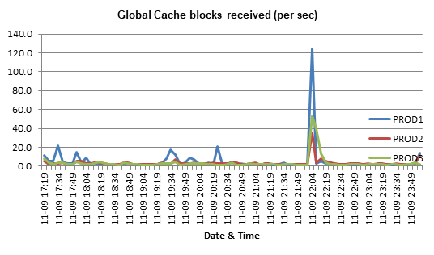

# AwrOne — Oracle AWR to Excel

Convert Oracle AWR data into Excel workbooks with charts.

An INI file defines what to collect (SQL queries, sheet layout, charts).
The pipeline collects from the database via SQL*Plus HTML spool and turns the
result into a formatted `.xlsx` with line charts per metric.

> Korean version: [README_ko.md](README_ko.md)
> (For Tibero TPR, see the sibling tool **TprOne** in [`../Tibero/`](../Tibero/).)

## Pipeline

```
INI ──AwrONE_ini_to_sql.py──▶ .sql ──SQL*Plus (spool HTML)──▶ .html ──AwrONE_html_to_excel.py──▶ .xlsx (with charts)
```

## Usage

### 1. Generate the collection SQL

```bash
python AwrONE_ini_to_sql.py -i Simple_AwrOne_2node.ini -o out.sql
```

### 2. Set the collection time window (required)

Open the generated `out.sql` and edit the two lines near the top:

```sql
exec :snapdate_from:=202611091705
exec :snapdate_to:=202611092359
```

- Format: `YYYYMMDDHH24MI` (year, month, day, hour, minute — local DB time).
- The shipped defaults (`202601010000`–`202601150000`) are placeholders;
  always set the range you actually want (e.g. an incident window or the last day).
- Snapshots whose interval overlaps the window are collected. If none overlap,
  the script stops with `ORA-20001: No AWR snapshots found ...`.
- `:inst_no` and `:dbid` are auto-detected from the connection — you only edit
  the two dates. For RAC ini files the instance numbers are preset
  (`:inst_no1:=1` … `:inst_noN:=N`); adjust them if your instances are
  numbered differently.

### 3. Collect with SQL*Plus

Run anywhere that has SQL*Plus and network access to the DB — there is no fixed
directory; the HTML report is written to the current directory.

- Single-family ini: run **once per node**, connecting to each instance
  (put `INSTANCE_NAME` in the connect string).
- RAC-family ini: run **once** against any instance — the queries already cover
  the whole cluster. (A `4node` ini on a 3-node cluster still works; the missing
  node shows as `inst#4` with no data.)

```bash
# Single family — once per node
sqlplus appdba/manager@"(DESCRIPTION=(ADDRESS=(PROTOCOL=TCP)(HOST=<node-vip>)(PORT=1521))(CONNECT_DATA=(SERVICE_NAME=<svc>)(INSTANCE_NAME=<inst>)))" @out.sql

# RAC family — once, any node
sqlplus appdba/manager@<host>/<svc> @out.sql
```

### 4. Convert to Excel

```bash
python AwrONE_html_to_excel.py -i AWR_RAC_Simple_2node_rac1_PROD1_20261110_192130.html
```

The converter reads the source ini name recorded inside the HTML and searches
the report's directory, the working directory, and the script directory; use
`-n <ini>` to override. The `.xlsx` (with charts) is written next to the HTML.
For `*_with_ash.ini` collections, convert the extra `..._ASH.html` the same way.

## Sample output

| `load` — Transactions/s per node | `rac_load` — Global Cache blocks received/s |
|---|---|
|  |  |

## Requirements

- Python 3.x standard library + `xlsxwriter` (`openpyxl` only for the verification scripts under `test/`)
- Oracle **12.2 or later** (queries are CDB/PDB-aware via `con_id`); SQL*Plus client
- AWR read access (Diagnostics Pack; an account with SELECT on `DBA_HIST_*`)

## Collection INI set

| ini | Purpose | How to run |
|---|---|---|
| `Simple_AwrOne_Single.ini` | Single-instance key metrics | Run on each RAC node |
| `Simple_AwrOne_Single_with_ash.ini` | Same + ASH (separate `_ASH.html`) | 〃 |
| `Full_AwrOne_Single.ini` | Single-instance full set (Top SQL, segments, ...) | 〃 |
| `Full_AwrOne_Single_with_ash.ini` | Same + ASH | 〃 |
| `Simple_AwrOne_{2..8}node.ini` | RAC node-comparison key metrics (2 to 8 nodes) | Once (cluster-wide) |
| `Full_AwrOne_{2..8}node.ini` | RAC node-comparison full set (2 to 8 nodes) | 〃 |

### Simple vs Full

- **Single-instance (`Simple` 33 sheets vs `Full` 102 sheets)**:
  - **`Simple`**: Fast daily/incident triage — DB/snap info, parameters, load profile, RAC load & GC efficiency, PGA/SGA/Undo/Redo/log switches, wait events (`wait5`/`wait20`/`wait_disk`/`redo_wait`/`wait_buffer`), time model, OS stats, instance activity, latch/enq/libcache, and key sysstat.
  - **`Full`**: Everything in `Simple` **plus** Top SQL by 7 metrics (elapsed, CPU, buffer gets, disk reads, executions, parses, cluster wait — series + summary + raw), 11 segment statistics (`seg_stat_*`), tablespace/datafile I/O (`tbsstat*`, `filestat*`), detailed RAC interconnect (`rac_char`, `rac_msg`, `rac_gesstat`, `rac_gccr/cu_srv`, `rac_gctran`), service stats, buffer pools, workarea histogram, latch/mutex/enq detail, rowcache, and parameter diff.
- **Multi-node RAC (`Simple` 9 sheets vs `Full` 19 sheets)**:
  - **`Simple`**: Core cluster comparison — `dbinfo`, `snapinfo`, `param`, `load`, `rac_load`, `rac_char`, `rac_msg`, `rac_gccr_srv`, `pga_hit`.
  - **`Full`**: Adds cluster-wide `param_sga`, `rac_gc_efficiency`, `wait5`, `bufpool`, `undo`, `mttr`, `sess_cache`, `log_ckpt`, `logswitch`, and `archsize`.
- **`*_with_ash.ini`**: Appends `[ash]` (capped at 150,000 rows) spooled to a separate `..._ASH.html` file.

## Output file naming

```
AWR_<NODE|RAC>_<tag>_<host>_<inst>_<yyyymmdd_hhmiss>.html
```

- `NODE` = Single-family ini, `RAC` = 2..8node ini
- `<tag>` = ini filename minus `AwrOne_`, compressed for brevity: `_Single` is dropped
  for the NODE family and `_with_ash` becomes `_ash`
  (e.g. `Simple_AwrOne_Single.ini` → `Simple`,
  `Full_AwrOne_Single_with_ash.ini` → `Full_ash`,
  `Simple_AwrOne_4node.ini` → `Simple_4node`)
- The timestamp includes seconds (`hhmiss`) so reruns within the same minute
  never overwrite earlier output
- Examples: `AWR_RAC_Simple_2node_rac1_PROD1_20261110_192130.html`,
  `AWR_NODE_Full_ash_rac1_PROD1_20261110_192145.html`
- ASH sections (`SPOOL=ash`) spool to a separate `..._ASH.html`
- Legacy names (`AWR_<host>_<inst>_....html`, minute-only `hhmi`) are still
  accepted by the converter

## Chart title variables

`@@hostname@@` and `@@instance@@` in a CHART title (used in Single-instance INIs)
are replaced from the input file name at conversion time (e.g.
`Transactions (per sec) - @@hostname@@` → `... - rac1`). Multi-node RAC charts
omit `@@hostname@@` because they plot all cluster nodes together.

## INI syntax quick reference

- Each `[section]` appears twice: a config block (`SQLn=`, `FORMAT`, `CHART`,
  `SPOOL=`) and a query block (starts with `select`). Only the query block goes
  into the SQL output; a `rem [section]` marker precedes it.
- Bind variables: `:snapdate_from` / `:snapdate_to` (requested range),
  `:snap_fr` / `:snap_to` (resolved snapshot ids), `:inst_no`, `:inst_no1..8`,
  `:dbid`.
- Chart anchor rule: the CHART column field = last data column of the sheet + 2.
  When you add/remove columns, shift the CHART/FORMAT column references too.

## Misc

- Collection/verification scripts and collected artifacts live in the repo's
  `test/final/` directory (not tracked by git).
