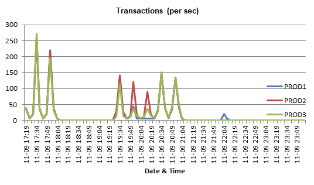
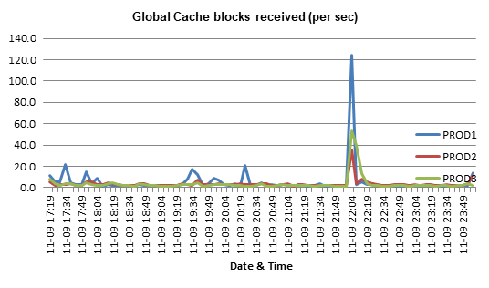

# AwrOne — Oracle AWR to Excel

Oracle AWR 데이터를 차트가 포함된 Excel 워크북으로 변환하는 도구입니다.

수집할 내용(SQL 쿼리, 시트 구성, 차트)은 INI 파일로 정의하고,
SQL*Plus HTML 스풀로 DB에서 수집한 뒤 지표별 라인 차트가 들어간
`.xlsx`로 변환합니다.

> English version: [README.md](README.md)
> (Tibero TPR용 형제 도구 **TprOne**은 [`../Tibero/`](../Tibero/)를 참조하세요.)

## 파이프라인

```
INI ──AwrONE_ini_to_sql.py──▶ .sql ──SQL*Plus(spool HTML)──▶ .html ──AwrONE_html_to_excel.py──▶ .xlsx(차트 포함)
```

## 사용법

### 1. 수집용 SQL 생성

```bash
python AwrONE_ini_to_sql.py -i Simple_AwrOne_2node.ini -o out.sql
```

### 2. 수집 시간대 지정 (필수)

생성된 `out.sql` 상단의 두 줄을 원하는 구간으로 바꿉니다:

```sql
exec :snapdate_from:=202611091705
exec :snapdate_to:=202611092359
```

- 형식: `YYYYMMDDHH24MI` (년월일시분, DB 서버 로컬 시각).
- 기본값(`202601010000`~`202601150000`)은 자리 표시자이므로 반드시 원하는 구간
  (예: 장애 시간대, 최근 하루)으로 바꿔서 실행하세요.
- 구간과 겹치는 스냅샷을 수집하며, 겹치는 스냅샷이 없으면
  `ORA-20001: No AWR snapshots found ...` 오류로 멈춥니다.
- `:inst_no`, `:dbid`는 접속 정보에서 자동으로 얻으므로 날짜 두 줄만 바꾸면 됩니다.
  RAC ini는 인스턴스 번호가 `:inst_no1:=1` … `:inst_noN:=N`으로 미리 설정돼 있고,
  인스턴스 번호가 다르면 이 값들을 수정하면 됩니다.

### 3. SQL*Plus로 수집

SQL*Plus와 DB 네트워크 접속만 있으면 아무 곳에서나 실행할 수 있습니다. 고정된
디렉터리는 없으며, 결과 HTML은 현재 디렉터리에 생깁니다.

- Single 계열 ini: `INSTANCE_NAME`을 지정해 각 인스턴스에 접속, **노드별로 1회씩** 실행.
- RAC 계열 ini: 아무 인스턴스에나 **1회** 실행 — 쿼리가 클러스터 전체를 커버합니다.
  (3노드 클러스터에서 `4node` ini를 써도 동작하며, 없는 노드는 `inst#4`로 표시되고 데이터는 비어 있습니다.)

```bash
# Single 계열 — 노드별 1회
sqlplus appdba/manager@"(DESCRIPTION=(ADDRESS=(PROTOCOL=TCP)(HOST=<노드-vip>)(PORT=1521))(CONNECT_DATA=(SERVICE_NAME=<서비스>)(INSTANCE_NAME=<인스턴스>)))" @out.sql

# RAC 계열 — 아무 노드에 1회
sqlplus appdba/manager@<host>/<서비스> @out.sql
```

### 4. Excel로 변환

```bash
python AwrONE_html_to_excel.py -i AWR_RAC_Simple_2node_rac1_PROD1_20261110_192130.html
```

변환기는 HTML 안에 기록된 ini 이름을 자동으로 찾아 차트가 포함된 `.xlsx`를 생성합니다.

- 탐색 순서: 리포트 디렉터리 → 현재 디렉터리 → 스크립트 디렉터리 (`-n <ini>`로 직접 지정 가능).
- 출력 경로: 기본값은 입력 HTML과 같은 위치의 `.xlsx` (`-o <out.xlsx>`로 변경 가능).
- ASH 변환: `*_with_ash.ini`로 수집했다면 추가로 생긴 `..._ASH.html`도 같은 방법으로 변환합니다.

## 출력 예시

| `load` — 노드별 Transactions/s | `rac_load` — Global Cache blocks received/s |
|---|---|
|  |  |

## 요구 사항

- Python 3.x 표준 라이브러리 + `xlsxwriter` (`openpyxl`은 `test/` 아래 검증 스크립트에만 필요)
- Oracle **12.2 이상** (`con_id` 기반으로 CDB/PDB를 인식하는 쿼리 사용); SQL*Plus 클라이언트
- AWR 읽기 권한 (Diagnostics Pack; `DBA_HIST_*`에 SELECT 가능한 계정)

## 수집 INI 종류

| ini | 용도 | 실행 |
|---|---|---|
| `Simple_AwrOne_Single.ini` | 단일 인스턴스 핵심 지표 | RAC 각 노드에서 실행 |
| `Simple_AwrOne_Single_with_ash.ini` | 위 + ASH (별도 `_ASH.html`) | 〃 |
| `Full_AwrOne_Single.ini` | 단일 인스턴스 전체 (Top SQL, Segment 등) | 〃 |
| `Full_AwrOne_Single_with_ash.ini` | 위 + ASH | 〃 |
| `Simple_AwrOne_{2..8}node.ini` | RAC 노드 비교 핵심 지표 (2~8노드) | 1회 (클러스터 단위) |
| `Full_AwrOne_{2..8}node.ini` | RAC 노드 비교 전체 (2~8노드) | 〃 |

### Simple vs Full — 전체 추출 대상 `[섹션]` 상세 목록

#### 1. 단일 인스턴스 INI (`Simple_AwrOne_Single.ini` vs `Full_AwrOne_Single.ini`)

- **`Simple` (33개 시트 — `Simple`과 `Full` 공통 포함)**:
  - **환경 및 파라미터**:
    - `[dbinfo]` — 인스턴스/호스트/DB명, DBID, 버전, RAC 여부, 수집 스냅샷 시작/종료 시각
    - `[snapinfo]` — 스냅샷 ID 목록, 스냅 시각, 구간 길이(초), 인스턴스 기동 시각
    - `[param]` — DB 초기화 파라미터 목록
    - `[param_sga]` — SGA/PGA 메모리 관련 핵심 파라미터(`sga_target`, `db_cache_size`, `shared_pool_size` 등)
  - **부하 프로필 및 RAC/시스템 지표**:
    - `[load]` — Load Profile 시계열(DB Time, DB CPU, Redo, 논리/물리 읽기·쓰기, MB/s, User Calls, Parse/Hard Parse, Sort, Logon, Exec, Tx, 주요 Hit율)
    - `[rac_load]` — Global Cache 블록 수신/전송, 인터커넥트 트래픽, CR/Current 블록 생성·전송 시간
    - `[rac_gc_efficiency]` — 버퍼 접근 효율(`local %`, `remote %`, `disk %`)
    - `[time_model]` — Time Model 통계(`DB time`, `DB CPU`, SQL 실행/파싱/하드파싱, PL/SQL, 접속 관리 시간)
    - `[osstat]` — OS CPU 사용률(`busy`, `user`, `sys`, `iowait`, `idle`), Load Average, CPU/코어/소켓 수, 물리 메모리
    - `[inst_activity]` — 핵심 인스턴스 활동 지표(Commit, Rollback, Execute, Parse, Redo Entries, Table Scan 등)
    - `[sysstat_key]` — 주요 내부 카운터(인덱스 분할, 블록 클린아웃, 버퍼 스캔, DBWR 체크포인트 요청 등)
    - `[xd_sysstat]` — Exadata Smart Scan / 스토리지 셀 오프로드 통계
  - **대기 이벤트 및 서비스**:
    - `[wait5]` — 스냅샷별 Top 5 대기 이벤트 시계열(대기 횟수, 총 대기시간, 평균 대기 ms, `% DB time`)
    - `[wait20]` — 스냅샷별 Top 20 대기 이벤트 시계열(대기 횟수, 총 대기시간, 평균 대기 ms, `% DB time`)
    - `[wait15_raw]` — 스냅샷별 Top 15 대기 이벤트 원본 목록(Wait Class, 대기 횟수, 타임아웃, 대기시간, 평균 ms)
    - `[wait_disk]` — 디스크 I/O 대기 이벤트 상세(`db file sequential read`, `scattered read`, `direct path read/write` 등)
    - `[redo_wait]` — Redo/커밋 관련 대기 상세(`log file sync`, `log file parallel write`, `log file switch*`, `log buffer space`)
    - `[wait_buffer]` — 버퍼 경합 대기 상세(`buffer busy waits`, `read by other session`, `free buffer waits`, `gc buffer busy*`, `write complete waits`)
    - `[waitstat]` — 블록 클래스별 버퍼 대기 통계(`data block`, `undo header`, `undo block`, `segment header`)
    - `[service_wait]` — 서비스별 DB Time, CPU, 물리/논리 읽기 및 대기 클래스별 시간
  - **메모리, Undo, Redo 및 동시성**:
    - `[sga]` — SGA 영역별 크기 추이(Buffer Cache, Shared Pool, Large/Java/Streams Pool, Free 메모리)
    - `[pga]` — PGA 메모리 할당량/사용량/최대값 및 Cache Hit %
    - `[pga_hit]` — SQL Workarea 실행 비율(`optimal %`, `onepass %`, `multipass %`)
    - `[libcache]` — 네임스페이스별 Library Cache 활동(Gets, Pins, Pin Hit %, Reloads, Invalidations)
    - `[latch]` — 대기시간 기준 Top 5 Latch 시계열(대기시간, Miss Ratio %, Misses)
    - `[enq]` — 총 대기시간 기준 Top 5 Enqueue 락 대기 시계열
    - `[undo]` — Undo 사용량(Undo 블록, 트랜잭션 수, 최대 쿼리 길이, `ORA-01555` 에러, 공간 부족 에러)
    - `[mttr]` — 인스턴스 복구 MTTR 목표치 대비 추정 복구 시간 및 더티 버퍼 수
    - `[resource]` — `DBA_HIST_RESOURCE_LIMIT` 자원 사용량(`processes`, `sessions`, `enqueue_locks` 등)
    - `[log_ckpt]` — 스레드별 Redo 로그 스위치 간격 요약(최소/최대/평균 분)
    - `[logswitch]` — 스레드별(`Thread#1..4`) 시간대별 Redo 로그 스위치 횟수
    - `[archsize]` — 스레드별 일자별 아카이브 로그 생성 개수 및 용량(MB)
    - `[sqlstat]` — 수집된 SQL 전체의 스냅샷별 요약(SQL 수, 1회성 SQL 수, 실행 수, Buffer Gets, Disk Reads, CPU/Elapsed 시간)

- **`Full` (`Simple` 33개에 아래 69개 상세 시트 추가 = 총 102개 시트)**:
  - **RAC 인터커넥트 심층 분석**:
    - `[rac_char]` — Global Enqueue / Global Cache 서비스 응답시간 및 메시지 처리 지연
    - `[rac_msg]` — 인터커넥트 메시지 큐 대기·전송 지연 및 티켓 통계
    - `[rac_gesstat]` — 주요 DLM/GES 통계(`DBA_HIST_DLM_MISC`: 직·간접 메시지 전송/수신, 흐름 제어, 큐 시간)
    - `[rac_gccr_srv]` — Global Cache CR 블록 서버 통계(빌드, 플러시, 전송 시간 및 블록 수)
    - `[rac_gccu_srv]` — Global Cache Current 블록 서버 통계(Pin, 플러시, 전송 시간 및 블록 수)
    - `[rac_gctran]` / `[rac_gctran_raw]` — 블록 클래스별 Global Cache 블록 전송·변환 시계열 및 원본
  - **7대 지표별 Top 10 SQL (지표당 3개 시트 = 21개 시트 + `[sql_stat]`)**:
    - `[sql_ela]` / `[sql_ela2]` / `[sql_ela_raw]` — **Elapsed Time(수행시간)** Top 10 SQL (시계열 차트 / SQL 텍스트 포함 요약표 / 스냅샷별 원본)
    - `[sql_cpu]` / `[sql_cpu2]` / `[sql_cpu_raw]` — **CPU Time** Top 10 SQL
    - `[sql_get]` / `[sql_get2]` / `[sql_get_raw]` — **Buffer Gets(논리적 읽기)** Top 10 SQL
    - `[sql_read]` / `[sql_read2]` / `[sql_read_raw]` — **Disk Reads(물리적 읽기)** Top 10 SQL
    - `[sql_exe]` / `[sql_exe2]` / `[sql_exe_raw]` — **Executions(실행 횟수)** Top 10 SQL
    - `[sql_parse]` / `[sql_parse2]` / `[sql_parse_raw]` — **Parse Calls(파싱 횟수)** Top 10 SQL
    - `[sql_clwait]` / `[sql_clwait2]` / `[sql_clwait_raw]` — **Cluster Wait Time(클러스터 대기)** Top 10 SQL
    - `[sql_stat]` — 스냅샷별 SQL 실행·플랜 상세 롤업
  - **11대 지표별 Top 5 세그먼트 통계**:
    - `[seg_stat_lio]` — 논리적 읽기(Logical Reads) Top 5 세그먼트
    - `[seg_stat_pio]` — 물리적 읽기(Physical Reads) Top 5 세그먼트
    - `[seg_stat_bbw]` — Buffer Busy Waits Top 5 세그먼트
    - `[seg_stat_rlw]` — Row Lock Waits Top 5 세그먼트
    - `[seg_stat_itlw]` — ITL Waits Top 5 세그먼트
    - `[seg_stat_gccrsv]` / `[seg_stat_gccusv]` — GC CR / Current 블록 전송 Top 5 세그먼트
    - `[seg_stat_gccrrc]` / `[seg_stat_gccurc]` — GC CR / Current 블록 수신 Top 5 세그먼트
    - `[seg_stat_gcbb]` — GC Buffer Busy 대기 Top 5 세그먼트
    - `[seg_stat_spused]` — 공간 사용량 증가(Space Used) Top 5 세그먼트
  - **테이블스페이스 및 데이터파일 I/O**:
    - `[tbsstat_total]` / `[filestat_total]` — 스냅샷별 전체 테이블스페이스·데이터파일 I/O 통계 원본
    - `[tbsstat]` / `[filestat]` — 물리적 읽기 상위 5개 테이블스페이스·데이터파일 시계열
    - `[filestat_avg_blks_per_rd]` — 1회 읽기당 평균 블록 수 상위 5개 데이터파일 시계열
    - `[filestat_avg_time_per_rd]` / `[filestat_avg_time_per_rd_topio]` — 평균 읽기 응답시간(ms) 상위 5개 데이터파일 시계열 및 원본
    - `[filestat_avg_bwt]` / `[filestat_avg_bwt_topio]` — 데이터파일 버퍼 대기시간 시계열 및 원본
  - **서비스, 메모리, 락 및 파라미터 상세**:
    - `[service_stat]` / `[service_stat_dbtime]` / `[service_stat_dbcpu]` / `[service_stat_lio]` / `[service_stat_pio]` — 서비스별 종합 통계 및 DB Time/DB CPU/논리 읽기/물리 읽기 시계열
    - `[wait5_raw]` — 스냅샷별 Top 5 대기 이벤트 원본 목록
    - `[workarea]` / `[workarea_raw]` — SQL Workarea 메모리 히스토그램 요약 및 원본
    - `[bufpool]` / `[bufpool_other]` — 기본(DEFAULT/KEEP/RECYCLE) 및 비표준 블록 크기 버퍼풀 통계
    - `[enq_av]` — 평균 대기시간 기준 Top 5 Enqueue 락 시계열
    - `[undo_sql]` — Undo 사용량 및 최장 수행 쿼리 SQL ID 매핑
    - `[latch_sleep]` / `[latch_miss]` / `[mutex_sleep]` — Sleep 횟수/Miss 비율 상위 5개 Latch 및 Library Cache Mutex Sleep
    - `[rowcache]` — 활성 Dictionary Cache(`DBA_HIST_ROWCACHE_SUMMARY`) Gets/Misses/Scans/DLM 통계
    - `[redo]` — Redo 로그 그룹·멤버 구성(`v$log` / `v$logfile`)
    - `[sess_cache]` — 세션 수 및 세션 커서 캐시 적중률 추이
    - `[param_diff]` — 스냅샷 구간 내 변경된 초기화 파라미터 이력

- **`*_with_ash.ini` (별도 `..._ASH.html`로 스풀되는 1개 시트 추가)**:
  - `[ash]` — 수집 구간 내 Active Session History(`DBA_HIST_ACTIVE_SESS_HISTORY`) 원본 샘플 (최대 150,000행 상한)

---

#### 2. 멀티노드 RAC INI (`Simple_AwrOne_{2..8}node.ini` vs `Full_AwrOne_{2..8}node.ini`)

- **`Simple` (9개 시트 — 클러스터 전체 노드 병렬 비교)**:
  - `[dbinfo]` — 클러스터 DB 기본 정보 및 활성 인스턴스
  - `[snapinfo]` — 인스턴스별 수집 스냅샷 구간 요약
  - `[param]` — 전 노드(`#1`..`#N`) 초기화 파라미터 병렬 비교표
  - `[load]` — 노드별 Load Profile 비교(DB Time, DB CPU, Redo, 논리/물리 읽기, User Calls, Execs, Parses, Tx 등)
  - `[rac_load]` — 노드별 Global Cache 블록 수신/전송, 인터커넥트 트래픽 및 물리 I/O 비교
  - `[rac_char]` — 노드별 Global Cache / Enqueue 처리 지연 비교
  - `[rac_msg]` — 노드별 인터커넥트 메시지 큐·전송 지연 비교
  - `[rac_gccr_srv]` — 노드별 Global Cache CR/Current 블록 서버 처리량 및 지연 비교
  - `[pga_hit]` — 노드별 PGA Cache Hit % 및 Workarea Optimal 실행 비율 비교

- **`Full` (`Simple` 9개에 아래 10개 클러스터 시트 추가 = 총 19개 시트)**:
  - `[param_sga]` — 전 노드 SGA/메모리 핵심 파라미터 병렬 비교표
  - `[rac_gc_efficiency]` — 노드별 버퍼 접근 효율(`local %`, `remote %`, `disk %`) 비교
  - `[wait5]` — 노드별 DB Time, DB CPU, 대기시간 비교
  - `[bufpool]` — 노드별 버퍼풀 적중률, Free Buffer 대기, Buffer Busy 대기 비교
  - `[undo]` — 노드별 Undo 블록, 트랜잭션 수, 최대 쿼리 길이 비교
  - `[mttr]` — 노드별 MTTR 목표치 및 추정 복구 시간 비교
  - `[sess_cache]` — 노드별 세션 수 및 세션 커서 캐시 비교
  - `[log_ckpt]` — 스레드별 Redo 로그 스위치 간격(최소/최대/평균 분) 요약
  - `[logswitch]` — 전 스레드 시간대별 Redo 로그 스위치 횟수
  - `[archsize]` — 전 스레드 일자별 아카이브 로그 생성 개수 및 용량(MB)

## 출력 파일명 규칙

```
AWR_<NODE|RAC>_<ini태그>_<host>_<inst>_<yyyymmdd_hhmiss>.html
```

- `NODE` = Single 계열 ini, `RAC` = 2..8node 계열 ini
- `<ini태그>` = ini 파일명에서 `AwrOne_`를 뺀 것. 길이를 줄이기 위해 NODE 계열의 `_Single`은
  생략하고 `_with_ash`는 `_ash`로 압축한다
  (예: `Simple_AwrOne_Single.ini` → `Simple`, `Full_AwrOne_Single_with_ash.ini` → `Full_ash`,
  `Simple_AwrOne_4node.ini` → `Simple_4node`)
- 시각은 초까지(`hhmiss`) 들어가 같은 분에 재실행해도 파일이 덮어쓰이지 않는다
- 예: `AWR_RAC_Simple_2node_rac1_PROD1_20261110_192130.html`,
  `AWR_NODE_Full_ash_rac1_PROD1_20261110_192145.html`
- ASH 섹션(SPOOL=ash)은 `..._ASH.html`로 별도 spool
- 구형식 `AWR_<host>_<inst>_....html`, 시각 `hhmi`(초 없음)도 변환기가 그대로 읽음

## 차트 제목 변수

Single 계열 ini의 CHART 제목에 쓰인 `@@hostname@@`, `@@instance@@`는 변환 시
입력 파일명에서 치환된다 (예: `Transactions (per sec) - @@hostname@@` →
`... - rac1`). 멀티노드 RAC 차트는 클러스터 전체 노드를 함께 그리므로
호스트명을 붙이지 않는다.

## INI 문법 요약

- `[section]`이 두 번 나온다: ① 설정 블록(`SQLn=`, `FORMAT`, `CHART`, `SPOOL=`),
  ② 쿼리 블록(select로 시작). 쿼리 블록만 SQL 출력에 들어가고 앞에 `rem [section]`
  마커가 붙는다.
- 바인드 변수: `:snapdate_from` / `:snapdate_to`(요청 구간), `:snap_fr` / `:snap_to`
  (확정된 스냅샷 id), `:inst_no`, `:inst_no1..8`, `:dbid`.
- 차트 앵커 규칙: CHART의 열(COL) 필드 = 해당 시트 데이터 끝 열 + 2.
  컬럼을 추가/삭제할 때는 CHART/FORMAT 열 참조도 함께 밀어줘야 한다.

## 기타

- 수집/검증 스크립트와 수집 산출물은 리포지터리의 `test/final/` 디렉터리에 있다(git 미추적).
