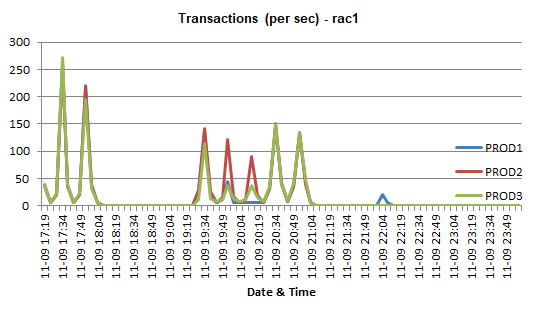
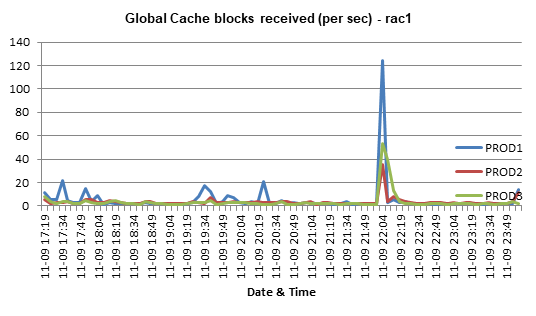

# AwrOne / TprONE

Convert Oracle AWR data into Excel workbooks with charts.

An INI file defines what to collect (SQL queries, sheet layout, charts).
The pipeline collects from the database via SQL*Plus HTML spool and turns the
result into a formatted `.xlsx` with line charts per metric.

> Korean version: [README_ko.md](README_ko.md)
> (Tibero TPR support is planned; the current INI set and tooling are Oracle AWR only.)

## Pipeline

```
INI ──AwrONE_ini_to_sql.py──▶ .sql ──SQL*Plus (spool HTML)──▶ .html ──AwrONE_html_to_excel.py──▶ .xlsx (with charts)
```

## Usage

### 1. Generate the collection SQL

```bash
python AwrONE_ini_to_sql.py -i Simple_AwrOne_2node.ini -o out.sql
```

### 2. Set the collection time window (required)

Open the generated `out.sql` and edit the two lines near the top:

```sql
exec :snapdate_from:=202611091705
exec :snapdate_to:=202611092359
```

- Format: `YYYYMMDDHH24MI` (year, month, day, hour, minute — local DB time).
- The shipped defaults (`202601010000`–`202601150000`) are placeholders;
  always set the range you actually want (e.g. an incident window or the last day).
- Snapshots whose interval overlaps the window are collected. If none overlap,
  the script stops with `ORA-20001: No AWR snapshots found ...`.
- `:inst_no` and `:dbid` are auto-detected from the connection — you only edit
  the two dates. For RAC ini files the instance numbers are preset
  (`:inst_no1:=1` … `:inst_noN:=N`); adjust them if your instances are
  numbered differently.

### 3. Collect with SQL*Plus

Run anywhere that has SQL*Plus and network access to the DB — there is no fixed
directory; the HTML report is written to the current directory.

- Single-family ini: run **once per node**, connecting to each instance
  (put `INSTANCE_NAME` in the connect string).
- RAC-family ini: run **once** against any instance — the queries already cover
  the whole cluster. (A `4node` ini on a 3-node cluster still works; the missing
  node shows as `inst#4` with no data.)

```bash
# Single family — once per node
sqlplus appdba/manager@"(DESCRIPTION=(ADDRESS=(PROTOCOL=TCP)(HOST=<node-vip>)(PORT=1521))(CONNECT_DATA=(SERVICE_NAME=<svc>)(INSTANCE_NAME=<inst>)))" @out.sql

# RAC family — once, any node
sqlplus appdba/manager@<host>/<svc> @out.sql
```

### 4. Convert to Excel

```bash
python AwrONE_html_to_excel.py -i AWR_RAC_Simple_2node_rac1_PROD1_20261110_192130.html
```

The converter reads the source ini name recorded inside the HTML and searches
the report's directory, the working directory, and the script directory; use
`-n <ini>` to override. The `.xlsx` (with charts) is written next to the HTML.
For `*_with_ash.ini` collections, convert the extra `..._ASH.html` the same way.

## Sample output

| `load` — Transactions/s per node | `rac_load` — Global Cache blocks received/s |
|---|---|
|  |  |

## Requirements

- Python 3.x standard library + `xlsxwriter` (`openpyxl` only for the verification scripts under `test/`)
- Oracle **12.2 or later** (queries are CDB/PDB-aware via `con_id`); SQL*Plus client
- AWR read access (Diagnostics Pack; an account with SELECT on `DBA_HIST_*`)

## Collection INI set

| ini | Purpose | How to run |
|---|---|---|
| `Simple_AwrOne_Single.ini` | Single-instance key metrics | Run on each RAC node |
| `Simple_AwrOne_Single_with_ash.ini` | Same + ASH (separate `_ASH.html`) | 〃 |
| `Full_AwrOne_Single.ini` | Single-instance full set (Top SQL, segments, ...) | 〃 |
| `Full_AwrOne_Single_with_ash.ini` | Same + ASH | 〃 |
| `Simple_AwrOne_{2,3,4}node.ini` | RAC node-comparison key metrics | Once (cluster-wide) |
| `Full_AwrOne_{2,3,4}node.ini` | RAC node-comparison full set | 〃 |

## Output file naming

```
AWR_<NODE|RAC>_<tag>_<host>_<inst>_<yyyymmdd_hhmiss>.html
```

- `NODE` = Single-family ini, `RAC` = 2/3/4node ini
- `<tag>` = ini filename minus `AwrOne_`, compressed for brevity: `_Single` is dropped
  for the NODE family and `_with_ash` becomes `_ash`
  (e.g. `Simple_AwrOne_Single.ini` → `Simple`,
  `Full_AwrOne_Single_with_ash.ini` → `Full_ash`,
  `Simple_AwrOne_4node.ini` → `Simple_4node`)
- The timestamp includes seconds (`hhmiss`) so reruns within the same minute
  never overwrite earlier output
- Examples: `AWR_RAC_Simple_2node_rac1_PROD1_20261110_192130.html`,
  `AWR_NODE_Full_ash_rac1_PROD1_20261110_192145.html`
- ASH sections (`SPOOL=ash`) spool to a separate `..._ASH.html`
- Legacy names (`AWR_<host>_<inst>_....html`, minute-only `hhmi`) are still
  accepted by the converter

## Chart title variables

`@@hostname@@` and `@@instance@@` in a CHART title are replaced from the input
file name at conversion time (e.g. `Transactions (per sec) - @@hostname@@` →
`... - rac1`).

## INI syntax quick reference

- Each `[section]` appears twice: a config block (`SQLn=`, `FORMAT`, `CHART`,
  `SPOOL=`) and a query block (starts with `select`). Only the query block goes
  into the SQL output; a `rem [section]` marker precedes it.
- Bind variables: `:snapdate_from` / `:snapdate_to` (requested range),
  `:snap_fr` / `:snap_to` (resolved snapshot ids), `:inst_no`, `:inst_no1..6`,
  `:dbid`.
- Chart anchor rule: the CHART column field = last data column of the sheet + 2.
  When you add/remove columns, shift the CHART/FORMAT column references too.
- See `CLAUDE.md` for full conventions and working rules.

## Misc

- `DPI/` holds the original 11g-era reference INI files (read-only reference).
- `test/final/` holds collection/verification scripts and collected artifacts
  (not tracked by git).
