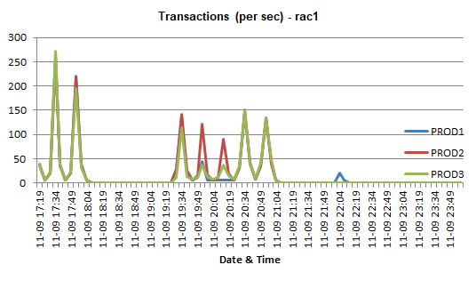
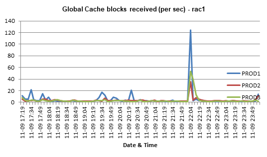

# AwrOne / TprONE

Oracle AWR 데이터를 차트가 포함된 Excel 워크북으로 변환하는 도구입니다.

수집할 내용(SQL 쿼리, 시트 구성, 차트)은 INI 파일로 정의하고,
SQL*Plus HTML 스풀로 DB에서 수집한 뒤 지표별 라인 차트가 들어간
`.xlsx`로 변환합니다.

> English version: [README.md](README.md)
> (Tibero TPR 지원은 예정되어 있으며, 현재 INI 세트와 도구는 Oracle AWR 전용입니다.)

## 파이프라인

```
INI ──AwrONE_ini_to_sql.py──▶ .sql ──SQL*Plus(spool HTML)──▶ .html ──AwrONE_html_to_excel.py──▶ .xlsx(차트 포함)
```

```bash
# 1) ini -> sql 생성
python AwrONE_ini_to_sql.py -i Simple_AwrOne_2node.ini -o out.sql

# 2) DB 접속해 수집 (스냅샷 범위는 out.sql 헤더의 snapdate_from/to 로 지정)
sqlplus appdba/manager@<host>/<svc> @out.sql

# 3) html -> xlsx (차트 포함)
python AwrONE_html_to_excel.py -i AWR_RAC_Simple_2node_rac1_PROD1_20261110_192130.html
```

## 출력 예시

| `load` — 노드별 Transactions/s | `rac_load` — Global Cache blocks received/s |
|---|---|
|  |  |

## 요구 사항

- Python 3.x 표준 라이브러리 + `xlsxwriter` (`openpyxl`은 `test/` 아래 검증 스크립트에만 필요)
- Oracle **12.2 이상** (`con_id` 기반으로 CDB/PDB를 인식하는 쿼리 사용); SQL*Plus 클라이언트
- AWR 읽기 권한 (Diagnostics Pack; `DBA_HIST_*`에 SELECT 가능한 계정)

## 수집 INI 종류

| ini | 용도 | 실행 |
|---|---|---|
| `Simple_AwrOne_Single.ini` | 단일 인스턴스 핵심 지표 | RAC 각 노드에서 실행 |
| `Simple_AwrOne_Single_with_ash.ini` | 위 + ASH (별도 `_ASH.html`) | 〃 |
| `Full_AwrOne_Single.ini` | 단일 인스턴스 전체 (Top SQL, Segment 등) | 〃 |
| `Full_AwrOne_Single_with_ash.ini` | 위 + ASH | 〃 |
| `Simple_AwrOne_{2,3,4}node.ini` | RAC 노드 비교 핵심 지표 | 1회 (클러스터 단위) |
| `Full_AwrOne_{2,3,4}node.ini` | RAC 노드 비교 전체 | 〃 |

## 출력 파일명 규칙

```
AWR_<NODE|RAC>_<ini태그>_<host>_<inst>_<yyyymmdd_hhmiss>.html
```

- `NODE` = Single 계열 ini, `RAC` = 2/3/4node 계열 ini
- `<ini태그>` = ini 파일명에서 `AwrOne_`를 뺀 것. 길이를 줄이기 위해 NODE 계열의 `_Single`은
  생략하고 `_with_ash`는 `_ash`로 압축한다
  (예: `Simple_AwrOne_Single.ini` → `Simple`, `Full_AwrOne_Single_with_ash.ini` → `Full_ash`,
  `Simple_AwrOne_4node.ini` → `Simple_4node`)
- 시각은 초까지(`hhmiss`) 들어가 같은 분에 재실행해도 파일이 덮어쓰이지 않는다
- 예: `AWR_RAC_Simple_2node_rac1_PROD1_20261110_192130.html`,
  `AWR_NODE_Full_ash_rac1_PROD1_20261110_192145.html`
- ASH 섹션(SPOOL=ash)은 `..._ASH.html`로 별도 spool
- 구형식 `AWR_<host>_<inst>_....html`, 시각 `hhmi`(초 없음)도 변환기가 그대로 읽음

## 차트 제목 변수

ini의 CHART 제목에 `@@hostname@@`, `@@instance@@`를 쓰면 변환 시 입력 파일명에서
치환된다 (예: `Transactions (per sec) - @@hostname@@` → `... - rac1`).

## INI 문법 요약

- `[section]`이 두 번 나온다: ① 설정 블록(`SQLn=`, `FORMAT`, `CHART`, `SPOOL=`),
  ② 쿼리 블록(select로 시작). 쿼리 블록만 SQL 출력에 들어가고 앞에 `rem [section]`
  마커가 붙는다.
- 바인드 변수: `:snapdate_from` / `:snapdate_to`(요청 구간), `:snap_fr` / `:snap_to`
  (확정된 스냅샷 id), `:inst_no`, `:inst_no1..6`, `:dbid`.
- 차트 앵커 규칙: CHART의 열(COL) 필드 = 해당 시트 데이터 끝 열 + 2.
  컬럼을 추가/삭제할 때는 CHART/FORMAT 열 참조도 함께 밀어줘야 한다.
- 전체 규약과 작업 규칙은 `CLAUDE.md` 참조.

## 기타

- `DPI/` 의 원본 ini는 11g 시절 참조용(읽기 전용).
- `test/final/` 에는 수집/검증 스크립트와 수집 산출물이 있다(git 미추적).
