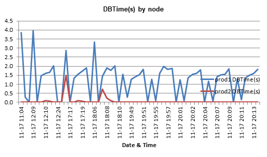
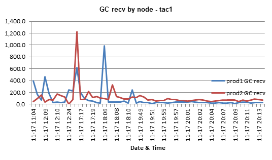

# TprOne — Tibero TPR to Excel

Convert Tibero TPR (Tibero Performance Repository) data into Excel workbooks with charts.

An INI file defines what to collect (SQL queries, sheet layout, charts).
The pipeline collects from the database via `tbsql` HTML spool and turns the
result into a formatted `.xlsx` with line charts per metric.

> Korean version: [README_ko.md](README_ko.md)
> (For Oracle AWR, see the sibling tool **AwrOne** in [`../Oracle/`](../Oracle/).)

## Pipeline

```
INI ──TprONE_ini_to_sql.py──▶ .sql ──tbsql (spool HTML)──▶ .html ──TprONE_html_to_excel.py──▶ .xlsx (with charts)
```

## Usage

### 1. Generate the collection SQL

```bash
python TprONE_ini_to_sql.py -i Simple_TprOne_2node.ini -o out.sql
```

- Report kind (`NODE` vs `TAC`) is inferred from the INI filename (`*Single*` → `NODE`, otherwise `TAC`) and cross-checked against the INI body; pass `-k {NODE,TAC}` to override explicitly.

### 2. Set the collection time window (required)

Open the generated `out.sql` and edit the two lines near the top:

```sql
exec :snapdate_from:=202611171100
exec :snapdate_to:=202611172359
```

- Format: `YYYYMMDDHH24MI` (year, month, day, hour, minute — local DB time).
- The shipped defaults (`202601010000`–`202601150000`) are placeholders;
  always set the range you actually want (e.g. an incident window or the last day).
- Snapshots whose interval falls inside the window (`begin_interval_time >= :snapdate_from`
  and `end_interval_time <= :snapdate_to`) are collected.
- Since `SYS._TPR_*` tables already store per-interval deltas, the first snapshot
  inside the window is included directly (no baseline `snap_id - 1` subtraction).
  If no snapshots match, the script stops with `ERROR-20001: No TPR ... snapshots found ...`.
- `:inst_no` and `:dbid` are auto-detected from the connection — you only edit
  the two dates.
- Tibero `THREAD#` / `INSTANCE_NUMBER` is **0-based** (`0..N-1`), so TAC ini files
  preset `:inst_no1:=0` … `:inst_no8:=7`; adjust them if your instances are
  numbered differently.

### 3. Collect with `tbsql`

Run anywhere that has `tbsql` and network access to the DB — there is no fixed
directory; the HTML report is written to the current directory.

- Single-family ini: run **once per node**, connecting to each instance.
- TAC (Tibero Active Cluster) ini: run **once** against any instance — the queries already cover
  the whole cluster grouped by global snapshot ID (`snap_gid`). (A `4node` or
  `8node` ini on a 2-node cluster still works; missing nodes show as `inst#<N>`
  with zero-filled series.)

```bash
# Single family — once per node
tbsql sys/<password>@<node1-conn> @out.sql
tbsql sys/<password>@<node2-conn> @out.sql

# TAC family — once, any node
tbsql sys/<password>@<any-node-conn> @out.sql
```

### 4. Convert to Excel

```bash
python TprONE_html_to_excel.py -i TPR_TAC_Simple_2node_tac1_prod1_20261117_201453.html
```

- The converter reads the source ini name recorded inside the HTML and searches
  the report's directory, the working directory, and the script directory; use
  `-n <ini>` to override.
- The `.xlsx` (with charts) is written next to the HTML (or to `-o <out.xlsx>`).
- Optional chart flags: `--x-rotation DEG` (`-90..90`, default `-90`) and
  `--x-format FMT` (default `'mm-dd hh:mm'`; pass `""` to keep the INI's format).
- For `*_with_ash.ini` collections, convert the extra `..._ASH.html` the same way.

## Sample output

| `load` — DBTime(s) per node | `tac_load` — Global Cache blocks received |
|---|---|
|  |  |

## Requirements

- Python 3.x standard library + `xlsxwriter`
- Tibero **7 or later**; `tbsql` client
- Read access to `SYS._TPR_*`, `SYS._VT_*`, `V$*`, and `GV$*` views (e.g. `SYS`
  or an account granted SELECT on the TPR repository tables and dynamic views)
- Optional DB parameters:
  - `ACTIVE_SESSION_HISTORY=Y` is required for `*_with_ash.ini` to populate ASH rows
  - `TPR_SEGMENT_STATISTICS=Y` is required for `Full_*` segment statistics sheets (`seg_*`) to populate

## Collection INI set

| ini | Purpose | How to run |
|---|---|---|
| `Simple_TprOne_Single.ini` | Single-instance key metrics | Run on each TAC node |
| `Simple_TprOne_Single_with_ash.ini` | Same + ASH (separate `_ASH.html`) | 〃 |
| `Full_TprOne_Single.ini` | Single-instance full set (Top SQL, segments, ...) | 〃 |
| `Full_TprOne_Single_with_ash.ini` | Same + ASH | 〃 |
| `Simple_TprOne_{2,3,4,7,8}node.ini` | TAC node-comparison key metrics | Once (cluster-wide) |
| `Full_TprOne_{2,3,4,7,8}node.ini` | TAC node-comparison full set | 〃 |

## Output file naming

```
TPR_<NODE|TAC>_<tag>_<host>_<inst>_<yyyymmdd_hhmiss>.html
```

- `NODE` = Single-family ini, `TAC` = 2/3/4/7/8node ini
- `<tag>` = ini filename minus `TprOne_`, compressed for brevity: `_Single` is dropped
  for the NODE family and `_with_ash` becomes `_ash`
  (e.g. `Simple_TprOne_Single.ini` → `Simple`,
  `Full_TprOne_Single_with_ash.ini` → `Full_ash`,
  `Simple_TprOne_4node.ini` → `Simple_4node`)
- The timestamp includes seconds (`hhmiss`) so reruns within the same minute
  never overwrite earlier output
- Examples: `TPR_TAC_Simple_2node_tac1_prod1_20261117_201453.html`,
  `TPR_NODE_Full_ash_tac1_prod1_20261117_181040.html`
- ASH sections (`SPOOL=ash`) spool to a separate `..._ASH.html`

## Chart title variables

`@@hostname@@` and `@@instance@@` in a CHART title are replaced from the input
file name at conversion time (e.g. `DBTime(s) by node - @@hostname@@` →
`... - tac1`).

## INI syntax quick reference

- Each `[section]` appears twice: a config block (`SQLn=`, `FORMAT`, `CHART`,
  `SPOOL=`) and a query block (starts with `select`). Only the query block goes
  into the SQL output; a `rem [section]` marker precedes it.
- Bind variables: `:snapdate_from` / `:snapdate_to` (requested range),
  `:snap_fr` / `:snap_to` (resolved local snapshot ids), `:gid_fr` / `:gid_to`
  (resolved TAC global snapshot ids), `:inst_no`, `:inst_no1..8` (`0..7`),
  `:dbid`.
- Chart anchor rule: the CHART column field = last data column of the sheet + 2.
  When you add/remove columns, shift the CHART/FORMAT column references too.
