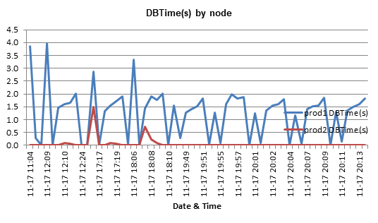
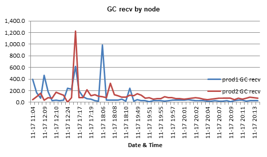

# TprOne — Tibero TPR to Excel

Tibero TPR(Tibero Performance Repository) 데이터를 차트가 포함된 Excel 워크북으로 변환하는 도구입니다.

수집할 내용(SQL 쿼리, 시트 구성, 차트)은 INI 파일로 정의하고,
`tbsql` HTML 스풀로 DB에서 수집한 뒤 지표별 라인 차트가 들어간
`.xlsx`로 변환합니다.

> English version: [README.md](README.md)
> (Oracle AWR용 형제 도구 **AwrOne**은 [`../Oracle/`](../Oracle/)를 참조하세요.)

## 파이프라인

```
INI ──TprONE_ini_to_sql.py──▶ .sql ──tbsql(spool HTML)──▶ .html ──TprONE_html_to_excel.py──▶ .xlsx(차트 포함)
```

## 사용법

### 1. 수집용 SQL 생성

```bash
python TprONE_ini_to_sql.py -i Simple_TprOne_2node.ini -o out.sql
```

- 리포트 종류(`NODE` vs `TAC`)는 INI 파일명(`*Single*` → `NODE`, 그 외 `TAC`)과 본문 바인드 변수로 자동 판별하며, `-k {NODE,TAC}` 옵션으로 직접 지정할 수도 있습니다.

### 2. 수집 시간대 지정 (필수)

생성된 `out.sql` 상단의 두 줄을 원하는 구간으로 바꿉니다:

```sql
exec :snapdate_from:=202611171100
exec :snapdate_to:=202611172359
```

- 형식: `YYYYMMDDHH24MI` (년월일시분, DB 서버 로컬 시각).
- 기본값(`202601010000`~`202601150000`)은 자리 표시자이므로 반드시 원하는 구간
  (예: 장애 시간대, 최근 하루)으로 바꿔서 실행하세요.
- 시작/종료 시각이 지정 구간 안에 포함되는 스냅샷(`begin_interval_time >= :snapdate_from`
  및 `end_interval_time <= :snapdate_to`)을 수집합니다.
- `SYS._TPR_*` 테이블은 이미 구간 증분(delta)을 저장하므로 첫 스냅샷부터 그대로
  포함되며(Oracle처럼 `snap_id - 1` 차감 불필요), 구간 내 스냅샷이 없으면
  `ERROR-20001: No TPR ... snapshots found ...` 오류로 멈춥니다.
- `:inst_no`, `:dbid`는 접속 정보에서 자동으로 얻으므로 날짜 두 줄만 바꾸면 됩니다.
- Tibero의 `THREAD#` / `INSTANCE_NUMBER`는 **0-based**(`0..N-1`)이므로 TAC ini는
  `:inst_no1:=0` … `:inst_no8:=7`로 미리 설정돼 있습니다. 인스턴스 번호가 다르면
  이 값들을 수정하면 됩니다.

### 3. `tbsql`로 수집

`tbsql`과 DB 네트워크 접속만 있으면 아무 곳에서나 실행할 수 있습니다. 고정된
디렉터리는 없으며, 결과 HTML은 현재 디렉터리에 생깁니다.

- Single 계열 ini: 각 인스턴스에 접속해 **노드별로 1회씩** 실행.
- TAC(Tibero Active Cluster) 계열 ini: 아무 인스턴스에나 **1회** 실행 — 쿼리가 글로벌 스냅샷 ID(`snap_gid`)
  기준으로 클러스터 전체를 커버합니다.
  (2노드 클러스터에서 `4node`나 `8node` ini를 써도 동작하며, 없는 노드는 `inst#<N>`으로
  표시되고 0으로 채워집니다.)

```bash
# Single 계열 — 노드별 1회
tbsql sys/<비밀번호>@<노드1-접속별칭> @out.sql
tbsql sys/<비밀번호>@<노드2-접속별칭> @out.sql

# TAC 계열 — 아무 노드에 1회
tbsql sys/<비밀번호>@<아무노드-접속별칭> @out.sql
```

### 4. Excel로 변환

```bash
python TprONE_html_to_excel.py -i TPR_TAC_Simple_2node_tac1_prod1_20261117_201453.html
```

변환기는 HTML 안에 기록된 ini 이름을 자동으로 찾아 차트가 포함된 `.xlsx`를 생성합니다.

- 탐색 순서: 리포트 디렉터리 → 현재 디렉터리 → 스크립트 디렉터리 (`-n <ini>`로 직접 지정 가능).
- 출력 경로: 기본값은 입력 HTML과 같은 위치의 `.xlsx` (`-o <out.xlsx>`로 변경 가능).
- 차트 X축 옵션: `--x-rotation DEG`(`-90..90`, 기본 `-90`), `--x-format FMT`(기본 `'mm-dd hh:mm'`, 빈 문자열 `""` 전달 시 INI 설정 유지).
- ASH 변환: `*_with_ash.ini`로 수집했다면 추가로 생긴 `..._ASH.html`도 같은 방법으로 변환합니다.

## 출력 예시

| `load` — 노드별 DBTime(s) | `tac_load` — Global Cache blocks received |
|---|---|
|  |  |

## 요구 사항

- Python 3.x 표준 라이브러리 + `xlsxwriter`
- Tibero **7 이상**; `tbsql` 클라이언트
- `SYS._TPR_*`, `SYS._VT_*`, `V$*`, `GV$*` 읽기 권한 (`SYS` 또는 해당 TPR 테이블·동적 뷰 SELECT 권한이 있는 계정)
- 선택적 DB 파라미터:
  - `ACTIVE_SESSION_HISTORY=Y`: `*_with_ash.ini`에서 ASH 데이터가 쌓이려면 활성화 필요
  - `TPR_SEGMENT_STATISTICS=Y`: `Full_*`의 세그먼트 통계 시트(`seg_*`)가 수집되려면 활성화 필요

## 수집 INI 종류

| ini | 용도 | 실행 |
|---|---|---|
| `Simple_TprOne_Single.ini` | 단일 인스턴스 핵심 지표 | TAC 각 노드에서 실행 |
| `Simple_TprOne_Single_with_ash.ini` | 위 + ASH (별도 `_ASH.html`) | 〃 |
| `Full_TprOne_Single.ini` | 단일 인스턴스 전체 (Top SQL, Segment 등) | 〃 |
| `Full_TprOne_Single_with_ash.ini` | 위 + ASH | 〃 |
| `Simple_TprOne_{2..8}node.ini` | TAC 노드 비교 핵심 지표 (2~8노드) | 1회 (클러스터 단위) |
| `Full_TprOne_{2..8}node.ini` | TAC 노드 비교 전체 (2~8노드) | 〃 |

### Simple vs Full 차이

- **단일 인스턴스 (`Simple` 35시트 vs `Full` 87시트)**:
  - **`Simple`**: 일상 점검·빠른 장애 1차 분석용 — DB/스냅샷 정보, 파라미터(`param`/`param_sga`/`param_diff`), Load Profile, TAC 부하/GC 효율, PGA/SGA/Undo/Redo/로그 스위치, 대기 이벤트(`wait5`/`wait20`/`wait_disk`/`redo_wait`/`wait_buffer`), Time Model, OS 통계, 인스턴스 활동, Latch/Enqueue/Libcache, 핵심 sysstat, `sysmetric`.
  - **`Full`**: `Simple` 전체 **+** 7개 지표별 Top SQL(Elapsed, CPU, Buffer Gets, Disk Reads, Execs, Parses, I/O Wait — 시계열·요약·원본), 리터럴 중복 SQL 분석, 세그먼트 통계(`seg_stat_lio/pio/bbw`), 테이블스페이스/파일 I/O(`tbsstat*`, `filestat*`), TAC 상세(`tac_char`, `tac_msg`, `tac_gesstat`, `tac_gccr/cu_srv`, `tac_gctran`), 버퍼풀, Workarea, 세션 수, Latch/Enq 상세, Rowcache, 아카이브 로그 목록.
- **멀티노드 TAC (`Simple` 9시트 vs `Full` 23시트)**:
  - **`Simple`**: 핵심 노드 비교 9종 — `dbinfo`, `snapinfo`, `param`, `load`, `tac_load`, `tac_char`, `tac_msg`, `tac_gccr_srv`, `pga_hit`.
  - **`Full`**: 위 9종 **+** 클러스터 단위 `param_sga`, `tac_gc_efficiency`, `wait5`, `bufpool`, `undo`, `ckpt_redo`, `sess_cache`, `redo`, `log_ckpt`, `logswitch`, `log_switch_f`, `log_switch`, `archsize`, `arch`.
- **`*_with_ash.ini`**: 별도 `..._ASH.html`로 스풀되는 `[ash]` 섹션(최대 150,000행 상한)을 추가합니다.

## 출력 파일명 규칙

```
TPR_<NODE|TAC>_<ini태그>_<host>_<inst>_<yyyymmdd_hhmiss>.html
```

- `NODE` = Single 계열 ini, `TAC` = 2..8node 계열 ini
- `<ini태그>` = ini 파일명에서 `TprOne_`를 뺀 것. 길이를 줄이기 위해 NODE 계열의 `_Single`은
  생략하고 `_with_ash`는 `_ash`로 압축한다
  (예: `Simple_TprOne_Single.ini` → `Simple`, `Full_TprOne_Single_with_ash.ini` → `Full_ash`,
  `Simple_TprOne_4node.ini` → `Simple_4node`)
- 시각은 초까지(`hhmiss`) 들어가 같은 분에 재실행해도 파일이 덮어쓰이지 않는다
- 예: `TPR_TAC_Simple_2node_tac1_prod1_20261117_201453.html`,
  `TPR_NODE_Full_ash_tac1_prod1_20261117_181040.html`
- ASH 섹션(`SPOOL=ash`)은 `..._ASH.html`로 별도 spool

## 차트 제목 변수

Single 계열 ini의 CHART 제목에 쓰인 `@@hostname@@`, `@@instance@@`는 변환 시
입력 파일명에서 치환된다 (예: `DB Time (s) - @@hostname@@` → `... - tac1`).
멀티노드 TAC 차트는 클러스터 전체 노드를 함께 그리므로 호스트명을 붙이지 않는다.

## INI 문법 요약

- `[section]`이 두 번 나온다: ① 설정 블록(`SQLn=`, `FORMAT`, `CHART`, `SPOOL=`),
  ② 쿼리 블록(`select`로 시작). 쿼리 블록만 SQL 출력에 들어가고 앞에 `rem [section]`
  마커가 붙는다.
- 바인드 변수: `:snapdate_from` / `:snapdate_to`(요청 구간), `:snap_fr` / `:snap_to`
  (확정된 로컬 스냅샷 id), `:gid_fr` / `:gid_to`(확정된 TAC 글로벌 스냅샷 id),
  `:inst_no`, `:inst_no1..8`(`0..7`), `:dbid`.
- 차트 앵커 규칙: CHART의 열(COL) 필드 = 해당 시트 데이터 끝 열 + 2.
  컬럼을 추가/삭제할 때는 CHART/FORMAT 열 참조도 함께 밀어줘야 한다.
